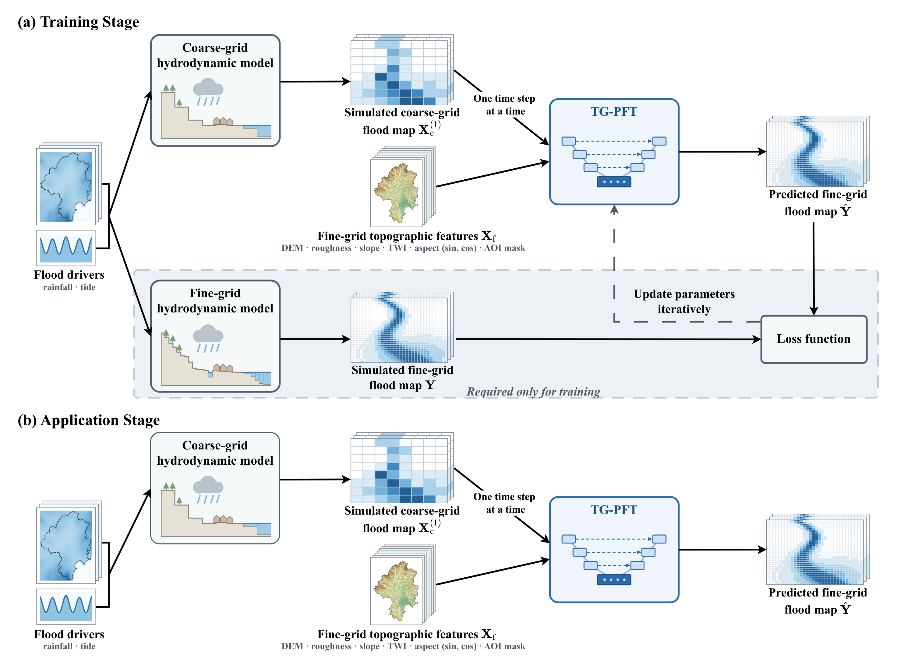
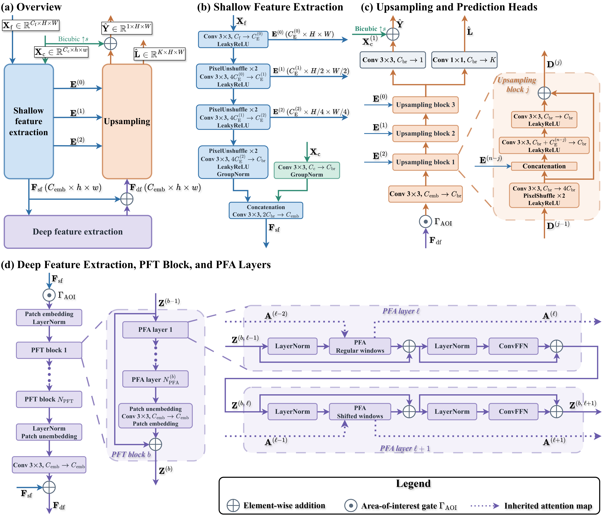

<div align="center">

# TG-PFT: A Topography-Guided Progressive Focused Transformer for Flood Map Downscaling

[Zihao Luo](https://profiles.auckland.ac.nz/zihao-luo),
[Zhonghou Xu](https://scholar.google.com/citations?user=uWjB9q8AAAAJ&hl=en),
[Conrad Zorn](https://scholar.google.co.nz/citations?user=KfNIHngAAAAJ&hl=en&oi=ao),
[Emily M. Lane](https://scholar.google.com/citations?user=Kka6oicAAAAJ&hl=en),
[Trevor Carey-Smith](https://scholar.google.com/citations?hl=en&user=ryK6lHUAAAAJ&view_op=list_works&sortby=pubdate),
[Jingfeng Zhang](https://scholar.google.com/citations?hl=en&user=NS0P1FkAAAAJ&view_op=list_works&sortby=pubdate),
[Yifan Yang](https://scholar.google.com.hk/citations?user=r95KMBUAAAAJ&hl=zh-CN&oi=sra)

[](https://arxiv.org/abs/XXXX.XXXXX)
[](https://www.python.org/)
[](https://pytorch.org/)
[](https://github.com/CyprienBosserelle/BG_Flood)
[](LICENSE)

</div>

This repository is an official implementation of the paper "TG-PFT: A Topography-Guided Progressive Focused Transformer for Flood Map Downscaling".

## 📖 Abstract

Flood warning and emergency response require timely, accurate, and spatially detailed flood maps. Fine-grid hydrodynamic simulations provide such maps but are computationally expensive. Coarse-grid simulations are faster but less accurate and lack spatial detail. Flood map downscaling addresses this trade-off by refining coarse-grid flood maps onto a fine grid. Recent studies use deep learning models from image super-resolution to learn this refinement. However, these studies do not fully exploit the fine-grid topography as guidance and overlook the severe imbalance between dry and flooded cells. We therefore propose the Topography-Guided Progressive Focused Transformer (TG-PFT) with multi-scale topographic guidance, which fuses the fine-grid topography at every scale during upsampling. To mitigate the imbalance between dry and flooded cells, we introduce an ordinal classification term and severity-balanced sampling. TG-PFT is trained on 18 flood scenarios forced by spatially and temporally varying design rainfall and a mean high water spring tide in the Gisborne catchment, New Zealand, and evaluated on six other scenarios and Ex-Tropical Cyclone Gabrielle. Results show that TG-PFT accurately reproduces the flooded extent and the values of the fine-grid water depth and flow velocities, while outperforming three existing flood map downscaling models. From a downscaling factor of 2 to 16, the speed-up over the fine-grid simulation rises from 2.78 to 144.79 with no observed decline in performance. We release the paired coarse- and fine-grid flood maps of the water depth and the flow velocities at four downscaling factors as a public benchmark to advance research on flood map downscaling.

<p align="center">
  
</p>
<p align="center"><b>Figure 1.</b> Overview of the proposed flood mapping framework. (a) Training stage, in which TG-PFT is trained on pairs of coarse- and fine-grid flood maps simulated by the hydrodynamic model under the same flood drivers. (b) Application stage, in which only the coarse-grid simulation is run, and the trained TG-PFT predicts the fine-grid flood map.</p>

<p align="center">
  
</p>
<p align="center"><b>Figure 2.</b> Architecture of TG-PFT, drawn for a downscaling factor of <i>s</i> = 8. (a) Overview. (b) Shallow feature extraction, including the topography encoder. (c) Upsampling and the two prediction heads, with upsampling block <i>j</i> expanded. (d) Deep feature extraction, with PFT block <i>b</i> and two consecutive PFA layers expanded.</p>

## 📑 Contents

- [Installation](#-installation)
- [Data and Pretrained Models](#-data-and-pretrained-models)
- [Results](#-results)
- [Repository Structure](#-repository-structure)
- [Getting Started](#-getting-started)
  - [Step 0: BG-Flood Simulations](#step-0-bg-flood-simulations)
  - [Step 1: Topographic Features](#step-1-topographic-features)
  - [Step 2: Projection and Artifact Removal](#step-2-projection-and-artifact-removal)
  - [Step 3: Patches](#step-3-patches)
  - [Step 4: Split and Standardization Statistics](#step-4-split-and-standardization-statistics)
  - [Step 5: Statistics for Severity-Balanced Sampling](#step-5-statistics-for-severity-balanced-sampling)
  - [Step 6: Training](#step-6-training)
  - [Step 7: Testing](#step-7-testing)
  - [Step 8: Evaluation](#step-8-evaluation)
  - [Step 9: Reassembling the Flood Maps](#step-9-reassembling-the-flood-maps)
- [Citation](#-citation)
- [Acknowledgements](#-acknowledgements)

## 🔧 Installation

We use two conda environments. `tgpft` is for training, testing, and evaluation. `tgpft-data` is for the GIS-based data preparation.

**Model environment (`tgpft`)**

```bash
git clone https://github.com/WilliamLUO0/TG-PFT.git
cd TG-PFT

conda create -n tgpft python=3.9 -y
conda activate tgpft
pip install torch==2.5.0 torchvision==0.20.0 --index-url https://download.pytorch.org/whl/cu121
pip install -r requirements.txt
python setup.py develop
```

TG-PFT uses the sparse matrix multiplication CUDA operator of [PFT](https://github.com/LabShuHangGU/PFT-SR). Compile it once on a machine with CUDA:

```bash
cd ops_smm
python setup.py install
cd ..
```

**Data environment (`tgpft-data`)**

```bash
conda create -n tgpft-data -c conda-forge python=3.10 geopandas rasterio rioxarray richdem xarray netcdf4 matplotlib scipy tqdm -y
```

The same packages are listed in `requirements_data.txt`. `richdem` installs most reliably from conda-forge.

## 📦 Data and Pretrained Models

**Dataset.** We release a public benchmark dataset of paired coarse- and fine-grid flood maps of the water depth and the flow velocities in the *x* and *y* directions at four downscaling factors. The flood maps are simulated by BG-Flood under spatially and temporally varying design rainfall and a time-varying mean high water spring tide. The dataset has two parts:

| Part | Content | DOI | License |
|:--|:--|:--|:--|
| Flood maps | BG-Flood outputs (`BGout.nc`), one file per simulation, with the design rainfall and the tide of the flood scenarios and the input files for running BG-Flood | https://doi.org/10.17608/k6.auckland.34803144 | CC BY-NC 4.0 |
| Inputs | Fine-grid topographic features and the rainfall and storm tide of Cyclone Gabrielle, with a copy of the BG-Flood outputs of Cyclone Gabrielle | https://doi.org/10.17608/k6.auckland.34863750 | CC BY-NC-ND 4.0 |

The flood maps are the shared intellectual property of the University of Auckland and Earth Sciences New Zealand (ESNZ). The DEM, the hydraulic roughness map, and the rainfall and storm tide of Cyclone Gabrielle are ESNZ data.

Extract the `.tar` files of both parts in one folder. This gives `input_files/` (`INPUT_DIR`) and `results/` (`RESULTS_DIR`), as in [Step 0](#step-0-bg-flood-simulations). Then skip Steps 0 and 1, and start from [Step 2](#step-2-projection-and-artifact-removal).

**Pretrained models.** We also release the pretrained TG-PFTs at https://doi.org/10.17608/k6.auckland.34849068:

| Flood variable | Downscaling factor | Name |
|:--|:--:|:--|
| Water depth | 2, 4, 8, 16 | `TGPFT_SRx2_h`, `TGPFT_SRx4_h`, `TGPFT_SRx8_h`, `TGPFT_SRx16_h` |
| Flow velocity in the *x* direction | 8 | `TGPFT_SRx8_u` |
| Flow velocity in the *y* direction | 8 | `TGPFT_SRx8_v` |

Put each model at `experiments/<name>/models/net_g_1000000.pth`, and you can go straight to [Step 7](#step-7-testing).

## 📊 Results

All result tables of the paper and its Supporting Information are in [assets/experimental_results.md](assets/experimental_results.md).

## 📂 Repository Structure

```
TG-PFT/
├── assets/                  # figures and result tables
├── basicsr/                 # BasicSR-based framework
│   ├── archs/               # TG-PFT, UNet (HeUNet), SwinFlood, RSwinUNet
│   ├── data/                # flood map dataset and severity-balanced sampling
│   ├── losses/              # masked L1 and L2 losses, ordinal classification term
│   ├── metrics/             # metrics used during validation
│   ├── models/              # training and validation
│   ├── train_flood_map.py   # training entry
│   └── test_flood_map.py    # testing entry
├── ops_smm/                 # sparse matrix multiplication CUDA operator (from PFT)
├── options/
│   ├── train/               # training configs (.yml) and SLURM scripts (.sh)
│   └── test/                # testing configs (.yml) and SLURM scripts (.sh)
└── scripts/
    ├── bgflood/             # Step 0: BG-Flood parameter files and job scripts
    ├── data/                # Steps 1-5: data preparation
    └── eval/                # Steps 8-9: evaluation and reassembling the flood maps
```

## 🚀 Getting Started

Run every command from the repository root. Each `.sh` file is a SLURM job script. Submit it with `sbatch`, or run it with `bash`. The paths to adapt are at the top of each script.

The study area is the Gisborne catchment, New Zealand. The fine grid has a resolution of 8 m. The four coarse grids, at 16, 32, 64, and 128 m, correspond to the downscaling factors of 2, 4, 8, and 16.

| Set | Rainfall | Fine grid | Coarse grids |
|:--|:--|:--:|:--:|
| Training and validation | Design rainfall, return periods of 2, 5, 10, 20, 50, 100, 200, 500, and 1000 years, durations of 6 h and 48 h | 8 m | 16, 32, 64, 128 m |
| Test sets | Design rainfall, return periods of 2, 5, 10, 50, 100, and 1000 years, duration of 42 h | 8 m | 64 m (100-year: 16, 32, 64, 128 m) |
| Test set, historical event | Cyclone Gabrielle, 11–15 February 2023 | 8 m | 16, 32, 64, 128 m |

Every flood scenario also has the same mean high water spring tide. Cyclone Gabrielle has its own rainfall and storm tide.

### Step 0: BG-Flood Simulations

All flood simulations use [BG-Flood](https://github.com/CyprienBosserelle/BG_Flood) (`ManyRivers` branch). The fine-grid simulation runs on an adaptive grid with a finest resolution of 8 m (`dx = 128` and `maxlevel = 4` in BG-Flood). The coarse-grid simulations run on uniform grids.

1. Put the model inputs in one folder (`INPUT_DIR`):

   ```
   INPUT_DIR/
   ├── Elevation.nc  Roughness.nc  aoi_BGFLOOD_mod.txt  Adapt.nc
   ├── tidebndpoly.bnd  tidebnd.nc
   ├── Gisborne_basin.shp  .shx  .dbf  .prj  .cpg     # catchment boundary, the AOI
   ├── <scenario>/<scenario>_nztm.nc     # design rainfall, e.g. 100y_42h_0c/100y_42h_0c_nztm.nc
   └── gabrielle/Rainfall_depth.nc  gabrielle/tide_Gisborne_96h.txt
   ```

2. Set `BG_FLOOD`, `INPUT_DIR`, and `RESULTS_DIR` in `scripts/bgflood/run_bgflood.sh`.

3. Run one simulation, or submit all of them:

   ```bash
   sbatch scripts/bgflood/run_bgflood.sh 100y_42h_0c 8
   bash scripts/bgflood/submit_all.sh
   ```

Each simulation writes `BGout.nc` to `RESULTS_DIR/<scenario>/dx<DX>/`.

### Step 1: Topographic Features

This step computes the slope, the sine and cosine of the aspect, and the topographic wetness index (TWI) from the 8 m DEM:

```bash
sbatch scripts/data/compute_topo_attrs.sh
```

The outputs go to `INPUT_DIR/Topo_Attrs/`.

### Step 2: Projection and Artifact Removal

First, the flood maps on the adaptive grid are projected onto the 8 m fine grid. Then the artifact of randomly distributed flooded cells over steep topography is removed from every flood map. Text S4 of the paper describes how.

```bash
sbatch scripts/data/filter_isolated_flood_cells.sh
```

### Step 3: Patches

The flood maps and the topographic features are cut into non-overlapping patches. A patch is 64 by 64 cells on the coarse grid and 64 × *s* by 64 × *s* cells on the fine grid. For training and validation, we keep the patches with at least 20% of their cells inside the area of interest (AOI). The test sets keep every patch that has a cell inside the AOI, so the full flood map can be reassembled.

```bash
sbatch scripts/data/make_patches.sh            # datasets for training and validation
sbatch scripts/data/make_patches_testset.sh    # test sets
```

This creates the following folders under `datasets/`:

```
datasets/
├── dataset_ds8_filtered_thr0p1_min5100_full/    # s = 8 (h, u, v)
├── dataset_ds2_filtered_thr0p1_min25100_full/   # s = 2 (h)
├── dataset_ds4_filtered_thr0p1_min10100_full/   # s = 4 (h)
├── dataset_ds16_filtered_thr0p1_min2100_full/   # s = 16 (h)
├── testdataset_{2y,5y,10y,50y,100y,1000y}42h0c/ # test sets, s = 8
├── testdataset_gabrielle/                       # Cyclone Gabrielle, s = 8
└── testdataset_{100y42h0c,gabrielle}_ds{2,4,16}/
```

Here `h` is the water depth, and `u` and `v` are the flow velocities in the *x* and *y* directions.

The `index.csv` of each dataset stores absolute paths. If you move a dataset, rewrite the path prefix:

```bash
python scripts/data/rewrite_index_paths.py --in_csv datasets/<dataset>/index.csv --inplace --rule /old/prefix /new/prefix
```

### Step 4: Split and Standardization Statistics

The patches of every flood scenario are split at random, 80% for training and 20% for validation. The statistics of the transformation and the standardization come from the training split only. The flow velocities use the same split as the water depth.

```bash
sbatch scripts/data/precompute_split_stats.sh
```

### Step 5: Statistics for Severity-Balanced Sampling

This step computes, for every sample, the fraction of its cells inside the AOI at each flooding severity level. Severity-balanced sampling uses these fractions to draw the training samples.

```bash
sbatch scripts/data/precompute_patch_severity_stats.sh
```

### Step 6: Training

| Config | Model | Flood variable | *s* | Loss function |
|:--|:--|:--|:--:|:--|
| `train_TGPFT_SRx8_h.yml` | TG-PFT | water depth | 8 | L<sub>1</sub> + ordinal classification term |
| `train_TGPFT_SRx8_u.yml` | TG-PFT | flow velocity in the *x* direction | 8 | L<sub>1</sub> + ordinal classification term |
| `train_TGPFT_SRx8_v.yml` | TG-PFT | flow velocity in the *y* direction | 8 | L<sub>1</sub> + ordinal classification term |
| `train_TGPFT_SRx{2,4,16}_h.yml` | TG-PFT | water depth | 2, 4, 16 | L<sub>1</sub> + ordinal classification term |
| `train_HeUNet_SRx8_h.yml` | UNet ([He et al., 2023](https://doi.org/10.1016/j.watres.2023.120057)) | water depth | 8 | L<sub>2</sub> |
| `train_SwinFlood_SRx8_h.yml` | SwinFlood ([Song et al., 2025](https://doi.org/10.1016/j.jhydrol.2025.133280)) | water depth | 8 | L<sub>2</sub> |
| `train_RSwinUNet_SRx8_h.yml` | RSwinUNet ([Song & Guan, 2026](https://github.com/songwk0924/Residual-SwinUNet-for-Flood-Surrogate-Modeling)) | water depth | 8 | L<sub>1</sub> |

All models are trained for 1,000,000 iterations with a batch size of 16, split over four GPUs:

```bash
torchrun --nproc_per_node=4 --standalone basicsr/train_flood_map.py \
  -opt options/train/train_TGPFT_SRx8_h.yml --launcher pytorch --auto_resume
```

Or submit the job script:

```bash
sbatch options/train/train_TGPFT_SRx8_h.sh
```

Checkpoints go to `experiments/<name>/models/`, and TensorBoard logs to `tb_logger/<name>/`.

### Step 7: Testing

The test configs load the exponential moving average of the parameters at the final iteration (`net_g_1000000.pth`). The predicted fine-grid flood maps go to `results/<name>/visualization/`.

| Model | Test configs |
|:--|:--|
| TG-PFT, *s* = 8 (h, u, v) | `val`, `2y42h`, `5y42h`, `10y42h`, `50y42h`, `100y42h`, `1000y42h`, `gabrielle` |
| TG-PFT, *s* = 2, 4, 16 (h) | `val`, `100y42h`, `gabrielle` |
| UNet, SwinFlood, RSwinUNet (h) | `val`, `100y42h`, `gabrielle` |

```bash
python basicsr/test_flood_map.py -opt options/test/test_TGPFT_SRx8_h_100y42h.yml
```

Or:

```bash
sbatch options/test/test_TGPFT_SRx8_h_100y42h.sh
```

### Step 8: Evaluation

`scripts/eval/eval_flood.py` evaluates the predicted fine-grid flood maps against the simulated ones. For example:

```bash
python scripts/eval/eval_flood.py \
  --index-csv datasets/testdataset_100y42h0c/index.csv \
  --vis-root results/TGPFT_SRx8_h_100y42h/visualization \
  --var h \
  --out-json results/TGPFT_SRx8_h_100y42h/eval_summary.json
```

For the flow velocities, use `--var u --abs` or `--var v --abs`.

`scripts/eval/eval_flood.sh` evaluates every test config, together with the bicubic interpolation of the coarse-grid flood map:

```bash
sbatch scripts/eval/eval_flood.sh
```

### Step 9: Reassembling the Flood Maps

`scripts/eval/assemble_flood_map.py` stitches the predicted patches back into full flood maps and saves them as NetCDF. For example:

```bash
python scripts/eval/assemble_flood_map.py \
  --index-csv datasets/testdataset_gabrielle/index.csv \
  --vis-root results/TGPFT_SRx8_h_gabrielle/visualization \
  --var h --scenario gabrielle --source pred \
  --out-dir results/TGPFT_SRx8_h_gabrielle/assembled
```

Use `--source gt` for the simulated fine-grid flood maps. To reassemble all test sets:

```bash
sbatch scripts/eval/assemble_flood_map.sh
```

## 📝 Citation

If you find this work useful, please cite:

```bibtex
@article{luo2026tgpft,
  title   = {TG-PFT: A Topography-Guided Progressive Focused Transformer for Flood Map Downscaling},
  author  = {Luo, Zihao and Xu, Zhonghou and Zorn, Conrad and Lane, Emily M. and Carey-Smith, Trevor and Zhang, Jingfeng and Yang, Yifan},
  journal = {arXiv preprint arXiv:XXXX.XXXXX},
  year    = {2026}
}
```

## 🙏 Acknowledgements

This code is built on [BasicSR](https://github.com/XPixelGroup/BasicSR) and [PFT-SR](https://github.com/LabShuHangGU/PFT-SR). The flood simulations use [BG-Flood](https://github.com/CyprienBosserelle/BG_Flood). RSwinUNet is adapted from its [official implementation](https://github.com/songwk0924/Residual-SwinUNet-for-Flood-Surrogate-Modeling). We thank the authors for sharing their code.

## 📄 License

This project is released under the [Apache 2.0 License](LICENSE). Third-party code is credited in [NOTICE](NOTICE). The two parts of the dataset have their own licenses, given in [Data and Pretrained Models](#-data-and-pretrained-models).
